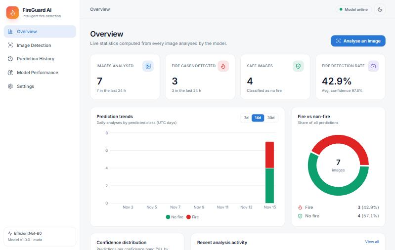
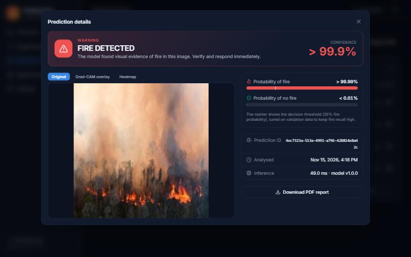
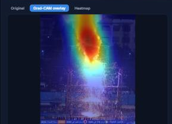
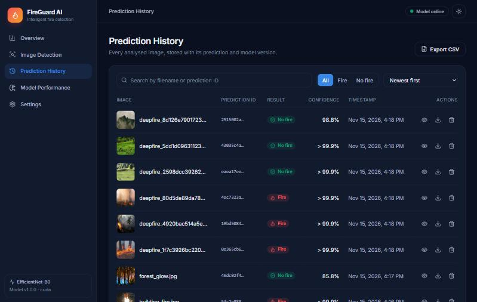
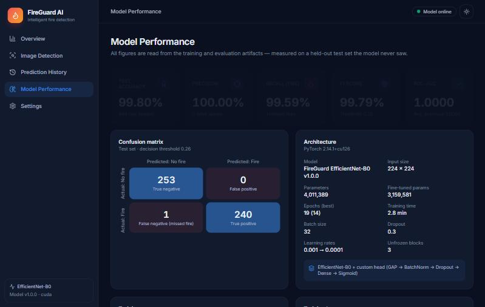
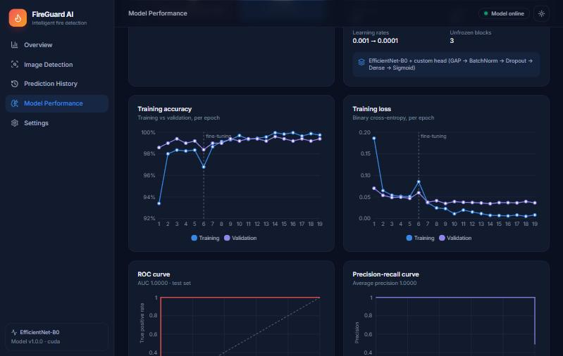
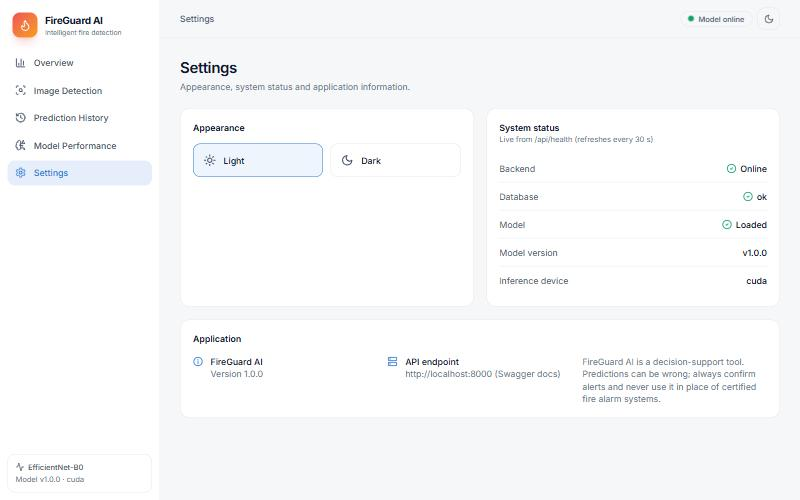

# FireGuard AI — Intelligent Image-Based Fire Detection

FireGuard AI is an end-to-end computer-vision application that tells you whether an image contains **fire** or **no fire**.
An EfficientNet-B0 network, fine-tuned on ~5,000 de-duplicated real images from three openly licensed datasets, sits
behind a FastAPI service. A React dashboard handles uploads, shows results with confidence scores and Grad-CAM
explanations, keeps a searchable history, charts live analytics, and offers PDF / CSV reports.

Nothing in the app is hardcoded: every prediction comes from the trained model, every dashboard number is computed from
the database, and every performance figure is read from the training and evaluation artifacts.

### Results on the held-out test set (494 images the model never saw)

| Accuracy | Precision (fire) | Recall (fire) | F1 | ROC-AUC | Missed fires | False alarms |
|---|---|---|---|---|---|---|
| **99.80 %** | **100.00 %** | **99.59 %** | **99.79 %** | **1.0000** | 1 / 241 | 0 / 253 |

Trained on an NVIDIA RTX 2050 (4 GB) in 2.8 minutes: 19 epochs, early-stopped, best epoch 14. The full log is in
`artifacts/reports/training_log.txt`.

> **Read these numbers with care.** The public datasets are dominated by clear daytime forest scenes and are much easier
> than real CCTV footage. The single missed fire is a small building fire in a night-time city scene, the kind of image
> that is rare in the training data. Expect lower accuracy on night, indoor, smoke-only or heavily compressed images.
> See [Limitations](#limitations).

---

## Contents

1. [System architecture](#system-architecture)
2. [Project structure](#project-structure)
3. [Datasets and licenses](#datasets-and-licenses)
4. [Quick start](#quick-start)
5. [Dataset preparation](#dataset-preparation)
6. [Model architecture and training](#model-architecture-and-training)
7. [Evaluation](#evaluation)
8. [Backend API](#backend-api)
9. [Frontend dashboard](#frontend-dashboard)
10. [Testing](#testing)
11. [Configuration reference](#configuration-reference)
12. [Troubleshooting](#troubleshooting)
13. [Screenshots](#screenshots)

---

## System architecture

```
┌──────────────────────────┐   multipart upload    ┌────────────────────────────────────────────────┐
│  React + Vite dashboard  │ ───────────────────▶  │ FastAPI  (backend/app)                          │
│  Tailwind · Recharts     │                       │  validate → re-encode → FirePredictor (loaded   │
│  Overview · Detect ·     │ ◀───────────────────  │  once at start-up) → Grad-CAM → SQLite via      │
│  History · Model · Set.  │   JSON + /media URLs  │  SQLAlchemy → JSON response                     │
└──────────────────────────┘                       └───────────────┬────────────────────────────────┘
                                                                   │ imports
                       ┌───────────────────────────────────────────▼────────────────────────────────┐
                       │ ml/  data download · cleaning/dedup/split · EfficientNet-B0 training ·      │
                       │      evaluation · inference + Grad-CAM          ──▶ artifacts/ (model,      │
                       │                                                      metrics, plots, reports)│
                       └─────────────────────────────────────────────────────────────────────────────┘
```

**Request flow:** Upload → `POST /api/predict` → type/size/format validation → decode + EXIF fix + RGB →
resize 224×224 + ImageNet normalisation → EfficientNet-B0 → sigmoid = P(fire) → validation-tuned threshold →
(optional) Grad-CAM → images saved under `backend/storage/uploads` → row inserted in `predictions` →
JSON result shown on the dashboard.

## Project structure

```
FireGuard-AI/
├── backend/
│   ├── app/
│   │   ├── main.py              # app factory, lifespan (loads model once), CORS, error handlers, static mounts
│   │   ├── api/                 # routes.py (all /api endpoints), deps.py (dependency injection)
│   │   ├── core/                # config.py (env settings), logging.py
│   │   ├── database/            # session.py (engine / sessions; swap URL for PostgreSQL)
│   │   ├── models/              # prediction.py (SQLAlchemy ORM table)
│   │   ├── schemas/             # Pydantic request/response models
│   │   ├── services/            # model, prediction, analytics, storage, report, model-info services
│   │   └── utils/               # image_validation.py
│   ├── requirements.txt
│   └── .env.example
├── frontend/
│   ├── src/
│   │   ├── components/          # Dropzone, ResultPanel, ProbabilityBars, Modal, shared UI
│   │   ├── pages/               # Overview, Detect, History, ModelPerformance, Settings
│   │   ├── layouts/             # AppLayout (sidebar, top bar, theme, health)
│   │   ├── services/api.js      # axios client
│   │   ├── hooks/               # useAsync, useHealth, useTheme
│   │   └── App.jsx
│   └── package.json
├── ml/
│   ├── config.py                # all paths + hyperparameters (env-overridable)
│   ├── data/                    # sources.py (dataset registry), download.py (resumable download)
│   ├── preprocessing/           # image_ops.py, transforms.py, prepare.py (clean / dedup / split)
│   ├── training/                # model.py, data.py, trainer.py
│   ├── evaluation/              # evaluate.py
│   └── inference/               # predictor.py (FirePredictor + Grad-CAM)
├── artifacts/                   # model/, metrics/, plots/, reports/  (produced by training/evaluation)
├── scripts/                     # download_dataset.py, prepare_dataset.py, train.py, evaluate.py
├── tests/                       # pytest suite (preprocessing, model, API, database, analytics)
├── requirements.txt
└── README.md
```

## Datasets and licenses

| Source | License | Content |
|---|---|---|
| [FIRE Dataset](https://www.kaggle.com/datasets/phylake1337/fire-dataset) (A. Saied, 2018) | CC0: Public Domain | 755 fire / 244 non-fire, indoor + outdoor scenes, many hard negatives (sunsets, lamps, red objects) |
| [Forest Fire Dataset — DeepFire](https://www.kaggle.com/datasets/alik05/forest-fire-dataset) (Khan et al., 2022) | CC BY 4.0 | 950 fire / 950 no-fire forest images |
| [Wildfire Detection Image Data](https://www.kaggle.com/datasets/brsdincer/wildfire-detection-image-data) (B. Dincer) | Open Database License (ODbL) | ~950 fire / ~950 no-fire forest images |

> DeepFire citation: A. Khan, B. Hassan, S. Khan, R. Ahmed, A. Abuassba, *“DeepFire: A Novel Dataset and Deep Transfer
> Learning Benchmark for Forest Fire Detection”*, Mobile Information Systems, 2022. CC BY 4.0 requires this attribution
> when you redistribute derived data.

The two forest datasets overlap heavily. The preparation step finds those duplicates with perceptual hashing and keeps a
single copy, so that one scene can't end up in both train and test. Larger datasets such as *The Wildfire Dataset*
(El-Madafri et al., CC BY 4.0, ~10 GB) and FLAME can be added to `ml/data/sources.py`. They were left out here because
they are too large to download reliably on the connection used.

## Quick start

Requirements: **Python 3.11 or 3.12**, **Node.js 18+**. An NVIDIA GPU is optional; everything also runs on CPU.

```bash
# 1. Python environment (from the FireGuard-AI folder)
python -m venv .venv
.venv\Scripts\activate            # Windows   |   source .venv/bin/activate  (macOS / Linux)
# optional, NVIDIA GPU: pip install torch torchvision --index-url https://download.pytorch.org/whl/cu126
pip install -r requirements.txt

# 2. Data + model
python scripts/download_dataset.py
python scripts/prepare_dataset.py
python scripts/train.py
python scripts/evaluate.py

# 3. Backend  (http://localhost:8000, Swagger at /docs)
cd backend
uvicorn app.main:app --reload --port 8000

# 4. Frontend (new terminal; http://localhost:5173)
cd frontend
npm install
npm run dev
```

## Dataset preparation

`python scripts/download_dataset.py` downloads every source in `ml/data/sources.py` with kagglehub. Public Kaggle
datasets need **no Kaggle account or API key**. Interrupted downloads resume automatically, with up to 20 attempts.
If a download keeps failing, fetch the zip manually from the Kaggle page, extract it, and register the folder:

```bash
python scripts/download_dataset.py --register deepfire=D:/downloads/forest-fire-dataset
```

`python scripts/prepare_dataset.py` then:

1. **Collects and labels** images from folder names, or from filename prefixes for flat folders such as DeepFire's `Testing/`.
2. **Removes corrupted files**. Every image is fully decoded, since a truncated JPEG only fails at decode time. Files whose shorter side is under 64 px are dropped.
3. **Removes duplicates**. Exact copies are found by MD5. Near-duplicates are found by perceptual hash (pHash Hamming distance ≤ 8) and grouped with union-find. The highest-resolution image in each group is kept.
   The threshold was chosen by inspecting image pairs: at ≤ 8 they were crops or rescales of the same photo, some of
   them across datasets; from 10 upwards they were different scenes.
4. **Drops label conflicts**. If the same image is labelled fire in one dataset and non-fire in another, the whole group is discarded.
5. **Splits** the de-duplicated set 70 / 15 / 15 into train / validation / test, stratified by class with `seed=42`. Because de-duplication happens before splitting, near-copies cannot leak between splits.
6. **Writes** RGB JPEGs (longest side ≤ 512 px) to `dataset/{train,validation,test}/{fire,non_fire}/`, plus
   `artifacts/metrics/dataset_manifest.csv`, `dataset_stats.json` and `artifacts/plots/class_distribution.png`.

Options: `--seed`, `--val`, `--test`, `--phash-threshold`, `--workers`. Raw and prepared data locations can be moved
with `FIREGUARD_RAW_DIR` / `FIREGUARD_DATASET_DIR` (see `.env.example`), which helps keep large data out of
synced folders.

## Model architecture and training

```
Input 224×224×3 → EfficientNet-B0 backbone (ImageNet weights) → Global Average Pooling
                → BatchNorm → Dropout(0.3) → Dense(1) → Sigmoid → P(fire)
```

Implemented in PyTorch (`ml/training/model.py`). PyTorch was chosen over TensorFlow because TensorFlow no longer
supports GPUs on native Windows, while PyTorch's CUDA wheels do.

Training (`python scripts/train.py`, `ml/training/trainer.py`):

| Stage | What trains | Optimiser / LR | Notes |
|---|---|---|---|
| 1. Head | classification head only (backbone frozen) | Adam, 1e-3 | 5 epochs max |
| 2. Fine-tune | last 3 backbone stages + head | Adam, 1e-4 | 15 epochs max |

* **Loss:** binary cross-entropy (`BCEWithLogitsLoss`) with `pos_weight = n_non_fire / n_fire` to offset class imbalance.
* **Scheduling:** `ReduceLROnPlateau` on validation loss (factor 0.3, patience 2).
* **Early stopping:** patience 5 on validation loss. The best checkpoint is restored before saving.
* **Frozen BatchNorm:** BN layers in frozen stages stay in eval mode, so their ImageNet statistics don't drift.
* **Augmentation (train only):** random resized crop / zoom (70–100 % area), horizontal flip, ±15° rotation,
  brightness ±20 %, contrast ±20 %. Hue and saturation are not jittered, because colour is a primary fire cue.
* **Mixed precision** on CUDA. Fixed seeds throughout.
* **Recall-first decision threshold:** after training, the threshold on P(fire) is tuned on the **validation** set to
  the highest-F1 value that keeps fire recall ≥ 95 %. A missed fire costs more than a false alarm. The test set is never
  used for tuning.

All hyperparameters are CLI flags, for example:

```bash
python scripts/train.py --batch-size 16 --head-epochs 3 --fine-tune-epochs 8 --fine-tune-blocks 2 \
                        --dropout 0.4 --fine-tune-lr 5e-5 --num-workers 0      # e.g. on a CPU-only laptop
```

Outputs: `artifacts/model/fireguard_efficientnet_b0.pt` (weights + metadata), `training_metadata.json`,
`class_labels.json`, `preprocessing.json`, `artifacts/metrics/training_history.csv`,
`artifacts/plots/training_accuracy.png`, `training_loss.png`, `artifacts/reports/training_log.txt`.

## Evaluation

`python scripts/evaluate.py` scores the checkpoint on the untouched test split and writes:

* `artifacts/metrics/test_metrics.json` — accuracy, precision, recall, F1, specificity, ROC-AUC, average precision, confusion matrix, full classification report
* `artifacts/metrics/curves.json` — down-sampled ROC / PR curves for the dashboard
* `artifacts/reports/classification_report.txt`
* `artifacts/plots/confusion_matrix.png`, `roc_curve.png`, `precision_recall_curve.png`

### Measured results

**Dataset after preparation (seed 42):** 4,799 raw images, 1,507 exact or near-duplicates removed, 0 corrupted, 0 label conflicts.
**3,292 unique images remain**. Images used per source: FIRE Dataset 927, DeepFire 1,868, Wildfire Detection 497.
Most of the Wildfire set duplicated DeepFire.

| Split | Fire | No fire | Total |
|---|---|---|---|
| Train | 1,124 | 1,180 | 2,304 |
| Validation | 241 | 253 | 494 |
| Test | 241 | 253 | 494 |

**Training:** the head phase reached 99.2 % validation accuracy after 5 epochs. Fine-tuning brought validation loss
from 0.047 to 0.034 (best at epoch 14), and early stopping ended the run at epoch 19. Threshold tuning on validation
picked **0.26**, giving 100 % validation fire recall at F1 0.996.

**Test set** (threshold 0.26):

```
              precision    recall  f1-score   support

    non_fire     0.9961    1.0000    0.9980       253
        fire     1.0000    0.9959    0.9979       241

    accuracy                         0.9980       494
```

Confusion matrix: TN 253 · FP 0 · FN 1 · TP 240. At the default 0.5 threshold the result is the same, because the
missed image (P(fire) = 0.245) falls below both thresholds. The hardest correctly classified negative, a forest lit
by orange glow and blue emergency lights, scored P(fire) = 0.144.

**Explainability check:** on a stadium image with both fireworks and a real fire, Grad-CAM puts the heat on the
flames and smoke column, not on the bright fireworks sparks. This suggests the model learned fire-specific
features, not just "bright orange pixels".

### Limitations

* Test accuracy is close to perfect because these benchmark datasets are relatively homogeneous. It does not
  guarantee real-world performance. For deployment, collect and evaluate on images from the target cameras.
* The model classifies whole images. It does not localise fires or detect smoke without visible flame.
* Adding larger, more varied sources (FLAME, D-Fire, The Wildfire Dataset) through `ml/data/sources.py` is the most
  effective next improvement.

## Backend API

Interactive docs: **http://localhost:8000/docs** (Swagger UI) and `/redoc`.

| Method | Endpoint | Description |
|---|---|---|
| `POST` | `/api/predict?gradcam=true` | Multipart `file` (JPG/JPEG/PNG/WEBP, ≤ 10 MB). Returns class, probabilities, confidence, ID, image / Grad-CAM URLs. `201` on success; `400` invalid image, `413` too large, `415` unsupported type, `503` model unavailable |
| `GET` | `/api/health` | Backend, database and model status |
| `GET` | `/api/analytics?days=14` | Totals, fire rate, average confidence / latency, daily trend, confidence histogram, recent predictions |
| `GET` | `/api/history?page=1&page_size=10&predicted_class=fire&search=…&sort=newest` | Paginated, filterable, searchable history |
| `GET` | `/api/history/export?predicted_class=…` | CSV export |
| `GET` | `/api/history/{id}` | One prediction |
| `DELETE` | `/api/history/{id}` | Delete the record and its stored images |
| `GET` | `/api/history/{id}/report` | PDF report (images, Grad-CAM, probabilities, model info) |
| `GET` | `/api/model-info` | Architecture, hyperparameters, dataset stats, test metrics, training history, curves, plot URLs |

Static files: `/media/uploads/*` (stored uploads, thumbnails, Grad-CAM renders) and `/artifacts/plots/*`.

Example:

```bash
curl -F "file=@forest.jpg" http://localhost:8000/api/predict
```

Design notes:

* The model is loaded **once** in FastAPI's lifespan handler and shared by all requests. If the checkpoint is missing
  the API still starts, `/api/health` reports `degraded` with the reason, and `/api/predict` returns `503`.
* Uploads are checked by extension, declared content type, size, and the format Pillow detects from the bytes. They are
  then fully decoded and **re-encoded** before storage. Files are named by prediction UUID, never by the user's filename,
  so EXIF/GPS metadata and any embedded payloads are stripped.
* SQLite is the default. Set `FIREGUARD_DATABASE_URL` to a PostgreSQL URL and install a driver, e.g. `psycopg`.
  The ORM and analytics queries use only portable SQL.

## Frontend dashboard

| Page | What it shows |
|---|---|
| **Overview** | KPI cards (images analysed, fire cases, safe images, fire rate), daily prediction trend (7/14/30 d), fire vs non-fire donut, confidence histogram, recent activity |
| **Image Detection** | Drag-and-drop or browse, preview, client-side validation, Grad-CAM toggle, upload/analysis progress, result panel (red warning / green all-clear, confidence, P(fire) vs P(no fire) with threshold marker, prediction ID, timestamp, original / overlay / heatmap views, PDF download) |
| **Prediction History** | Thumbnail table with search, class filter, sorting, pagination, detail modal, PDF download, delete with confirmation, CSV export |
| **Model Performance** | Test accuracy / precision / recall / F1 / ROC-AUC, confusion matrix, architecture and hyperparameters, training accuracy and loss curves, ROC and PR curves, dataset splits and sources, artifact plots |
| **Settings** | Light / dark theme, live backend / database / model status, model version, inference device, app info |

The backend URL comes from `VITE_API_URL` (default `http://localhost:8000`; see `frontend/.env.example`).
Fire and safe colours were checked with a colour-vision-deficiency validator. Every fire/safe indicator also has an icon
and a text label, so the result never depends on colour alone.

## Testing

```bash
pytest            # from the FireGuard-AI folder
```

The suite covers image preprocessing (decoding, EXIF, transparency, corruption, transforms, filename sanitising), the
model (head/backbone freezing, checkpoint loading, accuracy on held-out images, Grad-CAM consistency, threshold tuning),
the API end to end with the **real trained model** (prediction, persistence, static files, PDF report, invalid uploads,
size limits, history filter/search/pagination/delete, CSV export, analytics, model info), and the database
(persistence across restarts, analytics aggregation). Model-dependent tests are skipped if no checkpoint exists.

## Configuration reference

| Variable | Default | Used by |
|---|---|---|
| `FIREGUARD_RAW_DIR` | `./data_raw` | download / prepare |
| `FIREGUARD_DATASET_DIR` | `./dataset` | prepare / train / evaluate / tests |
| `FIREGUARD_ARTIFACTS_DIR` | `./artifacts` | train / evaluate |
| `FIREGUARD_DATABASE_URL` | `sqlite:///backend/storage/fireguard.db` | backend |
| `FIREGUARD_STORAGE_DIR` | `backend/storage` | backend |
| `FIREGUARD_MODEL_PATH` | `artifacts/model/fireguard_efficientnet_b0.pt` | backend |
| `FIREGUARD_DEVICE` | auto (`cuda` if available) | backend |
| `FIREGUARD_MAX_UPLOAD_MB` | `10` | backend |
| `FIREGUARD_ENABLE_GRADCAM` | `true` | backend |
| `FIREGUARD_CORS_ORIGINS` | `["http://localhost:5173","http://127.0.0.1:5173"]` | backend |
| `VITE_API_URL` | `http://localhost:8000` | frontend |

ML variables are read from the environment or a project-level `.env`. Backend variables are read from the environment or
`backend/.env`.

## Troubleshooting

| Problem | Fix |
|---|---|
| `Model checkpoint not found` / health shows *Model unavailable* | Run `scripts/train.py` (and `scripts/evaluate.py`), or point `FIREGUARD_MODEL_PATH` at an existing checkpoint, then restart the backend |
| Dashboard says *Cannot reach the backend* | Start uvicorn from the `backend` folder on port 8000, or set `VITE_API_URL` and restart `npm run dev` |
| CORS errors in the browser console | Add the frontend origin to `FIREGUARD_CORS_ORIGINS` |
| Dataset download keeps failing | It resumes on re-run. Otherwise download manually and use `--register key=folder` |
| `CUDA out of memory` while training | Lower `--batch-size` (e.g. 16 or 8) |
| Training is very slow on CPU | `--batch-size 16 --fine-tune-epochs 6 --fine-tune-blocks 2 --num-workers 0`; expect roughly 20–40 min per epoch |
| DataLoader worker errors on Windows | Use `--num-workers 0` |
| `torch.cuda.is_available()` is False with an NVIDIA GPU | Install the CUDA wheel: `pip install torch torchvision --index-url https://download.pytorch.org/whl/cu126` |
| Uploads rejected with 415 | Only JPEG, PNG and WEBP are accepted, detected from the file content, not just the extension |

## Screenshots

Captured from the running application with real model predictions.

| | |
|---|---|
|  |  |
| **Overview dashboard**: live KPIs, daily trend, class distribution | **Detection result**: warning banner, probabilities, threshold marker |
|  |  |
| **Grad-CAM**: the model focuses on flames and smoke, not fireworks | **Prediction history**: search, filter, report download, delete |
|  |  |
| **Model performance**: test metrics, confusion matrix, architecture | **Training curves**, ROC and PR curves from the artifacts |
|  | |
| **Settings**: theme, live backend and model status | |

## Disclaimer

FireGuard AI is a decision-support and educational project. Its accuracy is measured on public datasets that do not
cover every real-world condition (night scenes, CCTV compression, smoke-only fires). Never use it as a replacement for
certified fire detection and alarm systems.


## Raspberry Pi IoT hardware extension

The optional `hardware/` module supports Raspberry Pi 4 sensor acquisition using DHT11,
MQ-2 via MCP3008, and a digital IR flame sensor. See [hardware/README.md](hardware/README.md)
for wiring and setup notes. Configure the actual DHT11 and flame GPIO pins in
`hardware/config.py` before running `python -m hardware.run_monitor` on the Pi.

The backend accepts validated sensor records at `POST /api/sensors/telemetry` and appends
them to `backend/storage/sensor_telemetry.jsonl`. This endpoint is separate from the
existing image prediction endpoint. Sensor thresholds are prototype rules, not certified
fire-safety limits.
